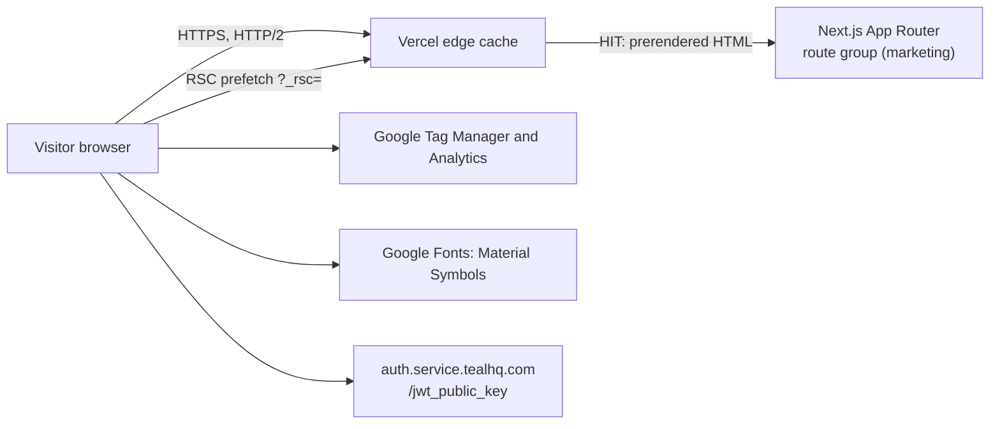

# 02. Architecture observations

Everything below is inferred from outside. See [`01-scope-and-methodology.md`](01-scope-and-methodology.md) for limits.

## Observed architecture

## Stack and hosting evidence

| Signal | Inference | Confidence |
|---|---|---|
| `server: Vercel`, `x-vercel-id`, `x-vercel-cache: HIT` | Hosted behind Vercel's edge network and CDN | Verified |
| `x-matched-path: /`, `x-nextjs-prerender: 1`, `x-nextjs-stale-time: 300` | Next.js App Router, homepage is statically prerendered | Verified |
| `vary: rsc, next-router-state-tree, next-router-prefetch, ...` | App Router content negotiation between HTML and RSC payloads | Verified |
| `/_next/static/chunks/app/(marketing)/...` | A `(marketing)` route group with per-route code splitting | Verified |
| `*-s.p.woff2` under `/_next/static/media/` | Fonts served through `next/font` (self-hosted) | Likely |
| `error-*.js`, `not-found-*.js`, `global-error-*.js` | Custom error, 404 and global-error boundaries exist | Verified that chunks load; behaviour untested |
| Let's Encrypt chain, HSTS `max-age=63072000` | Platform-managed TLS with auto-renewal | Likely |

## Route map (from navigation and prefetch traffic)

`/`, `/story`, `/team`, `/careers`, `/impact`, `/services`, `/products`, `/case-studies`, `/blog`, `/blog/<slug>`, `/contact`, `/bitelevate`, `/bitelevate/paths`, `/diaries`, plus `/privacy`, `/terms`, `/cookies`, `/navigation`. Product pages link to anchors on `/products`, not separate apps.

## API and payload structure

- **No first-party JSON API calls** were made by the homepage. All first-party data requests are Next.js RSC prefetches (`GET /<route>?_rsc=<hash>`).
- RSC requests carry `rsc: 1`, `next-router-prefetch: 1`, a `next-router-state-tree` header and `next-url`. They rely on `Vary` for cache separation.
- The public write paths (contact and newsletter forms) were **not exercised**, so their endpoint shape, validation and error format are unknown.
- RSC response bodies were not inspected.

## Caching behaviour

| Resource | Observation | Read |
|---|---|---|
| Homepage HTML | `public, max-age=0, must-revalidate`, edge `HIT`, `age: 410585` (about 4.75 days) | Standard for a prerendered Next.js page: browsers revalidate, the CDN serves instantly |
| Blog RSC response | `private, no-cache` (partly visible in DevTools) | Not edge-cacheable, which would explain slower non-home pages |
| `logo.svg` | Conditional request, 304, 223 ms | Revalidated on every visit rather than cached |
| `_next/static/*` | Mostly served from disk cache | Likely long-lived; headers not captured |

**Open question (low confidence):** the cached HTML was about 4.75 days old while `logo.svg` carried a `Last-Modified` of the same morning. This may be benign, since `Last-Modified` on static files can reflect serving time. It is worth confirming how and when prerendered pages are revalidated (ISR or on-demand) so content edits go live promptly.

## Third-party dependencies

| Dependency | Purpose | Risk note |
|---|---|---|
| Google Tag Manager / GA4 | Analytics | Consent handling unverified (SEC-08) |
| Google Fonts (CSS and woff2) | Material Symbols icon font | Render-blocking third-party CSS (PERF-05) |
| `auth.service.tealhq.com` | Public key fetch for JWT verification (inferred from the path) | Unneeded on a public page (SEC-07) |

## Error handling

The presence of `error`, `not-found` and `global-error` chunks is a good sign: unexpected exceptions and missing pages are meant to render a controlled UI rather than a stack trace. I did not test the 404 page or any error response.

## What was not observable

Application code, data stores, how contact and newsletter submissions are processed, authentication for the product apps, logging and monitoring, and any rate limiting.
